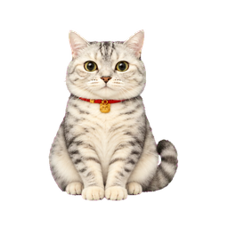
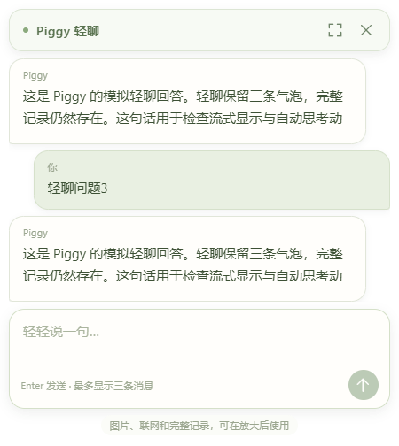

# Piggy Desktop 🐾

> ### 🎨 接受桌面宠物定制｜Custom Desktop Pet Commissions Open
>
> **承接专属桌面宠物定制与商务合作。** 欢迎通过 [Discussions](https://github.com/KellenLi666/piggy-desktop/discussions) 联系作者，沟通你的想法与需求。
>
> **Custom desktop pet commissions and business inquiries are welcome.** Contact the creator via [Discussions](https://github.com/KellenLi666/piggy-desktop/discussions) to discuss your ideas and requirements.

一只以真实猫咪 Piggy 为原型的 Windows 桌面宠物，也是一位使用你自己的 DeepSeek API 的聊天伙伴。

**Piggy Desktop is a Windows desktop companion with an animated cat, lightweight chat, and DeepSeek-powered conversations. Bring your own API key.**



[下载 Windows 免安装版](https://github.com/KellenLi666/piggy-desktop/releases/latest) · [反馈问题](https://github.com/KellenLi666/piggy-desktop/issues) · [交流讨论](https://github.com/KellenLi666/piggy-desktop/discussions)

> 适用于 Windows 10/11 x64。无需安装 ChatGPT、Node.js 或 Python 即可运行成品。聊天使用个人 DeepSeek API 密钥，API 费用由使用者自行承担。本项目与 OpenAI、ChatGPT、DeepSeek 无官方隶属关系。

## 介绍

Piggy 会待在透明悬浮窗口里，跟随鼠标看向不同方向，也能在桌面附近散步。悬停下方的文字按钮，即可在猫咪上方轻聊；需要阅读长回答、发送图片或联网搜索时，可以放大为完整聊天窗口。关闭聊天面板后，猫咪仍留在桌面。



作者：[KellenLi666](https://github.com/KellenLi666)。技术栈：Electron + TypeScript + React。

## 功能

- **桌面陪伴**：透明、无边框窗口；拖动移动、记住位置、可选置顶和自主散步。打开面板、聊天处理中、拖动或鼠标靠近时暂停散步。
- **原版猫咪动画**：待机、左右跑动、挥爪、跳跃、失落、等待、思考、检查及十六方向视线。输入、问候、请求、完成和失败会触发相应动作。
- **轻聊与完整聊天**：轻聊最多显示三条消息，完整会话仍保留；放大和收起共用会话与草稿。
- **文字对话**：连续上下文、流式输出、停止生成、复制回答、新建会话及本地历史。
- **图片理解**：完整聊天中支持选择、拖入和粘贴 PNG、JPEG、WebP；每次最多四张，每张不超过 10 MB，每边不超过 8192 像素，发送前可移除。
- **联网搜索**：完整聊天中按需开启，默认关闭；每轮最多三个搜索和三个网页读取操作，回答显示来源链接。部分临时失败最多自动重试一次，并显示错误。
- **自定义表达**：设置中编辑多行文风指令，可选择深度思考；默认模型为 `deepseek-flash`，连接 DeepSeek 官方接口。
- **托盘菜单**：显示/隐藏、暂停散步、动作预览、设置和退出。

首版不包含语音输入、文件文档解析、自动截图、电脑任务执行或跨会话长期记忆。宠物大小固定；轻聊不支持图片和联网，请使用放大窗口。

## 下载与安装

1. 打开 [Releases](https://github.com/KellenLi666/piggy-desktop/releases/latest)。
2. 在 **Assets** 中下载 `Piggy-Windows-x64-v1.1.1.zip`。GitHub 自动提供的 `Source code` 是源码，不能直接当成桌面程序运行。
3. 解压到一个独立文件夹，双击 `Piggy.exe`。
4. 保留解压目录中的所有文件，不要单独移动 EXE。程序无需管理员权限。

本项目尚未购买 Windows 代码签名证书，系统可能显示未知发布者。请核对下载来源与发行说明中的 SHA256，再自行决定是否运行。

更新时先从托盘退出旧版，再解压运行新版。没有自动更新功能；应用数据独立保存在当前 Windows 用户目录中。

## 使用方法

### 连接 DeepSeek

1. 点击 Piggy 下方右侧的**设置**按钮。
2. 在 [DeepSeek 开放平台](https://platform.deepseek.com/) 创建自己的 API 密钥，填入后点击保存。
3. 点击**测试连接**。它会发起一条短的真实 API 请求，可能产生少量费用；成功仅表示该请求成功，不代表所有图片和搜索能力均已验证。
4. 在设置中调整文风、置顶、自主散步和深度思考等选项。

程序不附带免费额度；ChatGPT 订阅不能用于抵扣 DeepSeek API 费用。不要把 API 密钥写进 Issue、截图或公开文件。

### 开始聊天

- 悬停文字按钮显示轻聊框，点击后输入；Enter 发送，Shift + Enter 换行。
- 点击轻聊框右上角的放大按钮，进入完整聊天。长回答、图片及联网搜索请在这里使用。
- 完整聊天中开启**联网搜索**后发送问题。仅有自然语言“我无法联网”不能证明服务状态，请结合黄色错误提示及本轮来源判断。
- 生成过程中可停止；失败后可再次发送。重试前可查看或调整输入。
- 关闭面板只会收起聊天；要结束程序，请使用系统托盘中的**退出**。

### 分享给朋友

发送完整 Windows ZIP 即可。朋友解压后填写自己的 API 密钥。不要发送 `%APPDATA%\PiggyDesktop`，它包含个人设置、聊天和图片。

## 数据与隐私

| 数据 | 保存位置或处理方式 |
| --- | --- |
| API 密钥 | Windows 系统加密存储，保存于当前用户应用数据目录；渲染界面不取得已保存密钥 |
| 聊天和图片 | 本机 `%APPDATA%\PiggyDesktop`，记录本身未加密 |
| 联网请求 | 由主进程直接发往 DeepSeek；发送的对话、图片、查询及网页读取参数由其服务处理 |
| 清除数据 | 设置中可删除密钥及清除全部聊天 |

没有项目自建服务器、项目账户或自动更新服务。网页和图片中的文字作为资料处理，不具备执行电脑任务的权限。Markdown 禁用原始 HTML，外部链接交给默认浏览器打开。

发行包不包含开发者密钥、个人聊天或原型照片。

## 从源码开发

以下命令在 **Windows PowerShell** 中执行。准备 Node.js 24 LTS、pnpm 11.25.0 和 Git；它们仅供开发，普通用户无需安装。

```powershell
git clone https://github.com/KellenLi666/piggy-desktop.git
cd piggy-desktop
npm install --global pnpm@11.25.0
pnpm install --frozen-lockfile --config.node-linker=hoisted
node node_modules/electron/install.js
pnpm run typecheck
pnpm test
pnpm run build
pnpm start
```

锁文件固定依赖版本，`pnpm-workspace.yaml` 声明允许执行的依赖构建脚本。安装依赖和 Electron 需要网络；构建及模拟测试无需真实 API 密钥。

### 构建成品

```powershell
pnpm run build
pnpm run package:dir
node scripts/notices.mjs
python scripts/export-release.py
```

`release/win-unpacked` 是可运行目录，`release/github` 包含 Windows ZIP、源码 ZIP 和校验文件。最后一步需要 Python 3；这是发布工具依赖，成品不依赖 Python。详见 [发布说明](docs/RELEASING.md)。

### 自动检查与测试

```powershell
pnpm run typecheck
pnpm test
pnpm run build
# 以下桌面测试需 Windows 图形会话；使用隔离目录和模拟响应
pnpm smoke
node scripts/test-quick-chat.mjs
node scripts/test-search-followup.mjs
```

GitHub Actions 在提交和 Pull Request 时运行类型检查、核心模拟测试与构建；不会使用真实密钥，也不会自动发布。桌面测试产生的 `.test-data`、`qa` 不提交。

当前本机验证：17 项核心测试、5 项搜索恢复检查、10 项成品启动检查；另有轻聊和拖动回归。网络测试使用模拟响应，不能替代真实 DeepSeek 账户、图片理解或搜索效果测试。Windows 10、其他电脑、多屏热插拔和不同缩放组合仍需实际验证。Actions 的远程结果以仓库运行记录为准。

## 项目结构

```text
src/          主进程、预加载桥接、界面、动作和 API 逻辑
assets/       原版精灵图和图标（单独许可）
tests/        核心模拟测试
scripts/      构建、桌面验证和打包工具
docs/         截图和发布说明
.github/      自动检查、问题反馈模板
```

## 常见问题

**没有密钥可以使用吗？** 可以使用桌宠、拖动、散步和设置；AI 聊天需要自己的密钥。

**连接成功但搜索失败？** 连接测试和搜索是不同请求。检查余额、服务权限和黄色提示中的 HTTP 状态。v1.1.1 会在新一轮开启搜索时重新尝试；持续失败请提交脱敏错误信息。

**关闭窗口后程序还在？** 这是桌宠的预期行为；请在托盘菜单选择退出。

**能在 macOS 或 Linux 使用吗？** 当前仅交付 Windows x64，其他平台未适配和验证。

## 反馈与贡献

- [Issues](https://github.com/KellenLi666/piggy-desktop/issues)：报告可复现问题或提出功能建议。
- [Discussions](https://github.com/KellenLi666/piggy-desktop/discussions)：交流使用体验和想法。
- Pull Request：提交代码修改供作者审查。请先阅读 [贡献说明](CONTRIBUTING.md)。

请勿公开密钥、个人聊天或含个人信息的截图。文档中的界面预览使用模拟对话，仅展示交互。

## 许可证与素材

原创代码及普通文档采用 [MIT](LICENSE)，允许在保留声明的前提下使用、修改和商用。第三方组件继续遵守其原许可证，见 [第三方说明](THIRD_PARTY.md)。

**Piggy 猫咪精灵图、图标及含这些形象的截图不采用 MIT。** 它们允许随本项目用于非商业使用和分享；单独转载、改作或任何商业使用须另行取得许可。完整范围见 [素材许可](assets/LICENSE.md)。这一限制意味着项目整体并非全部素材均按 MIT 开放。

动画由作者提供并获许可的猫咪照片经 AI 辅助制作，不公开原照片。精灵图 SHA256：`33f1f6609a90d53520802e7a41f52ce5569cf23c3a0fb8c2e22c6630c7b8e95d`。

## 致谢

基于 Electron、React、TypeScript、react-markdown、remark-gfm、Zod 等项目构建。开发与文档整理使用 AI 辅助。
